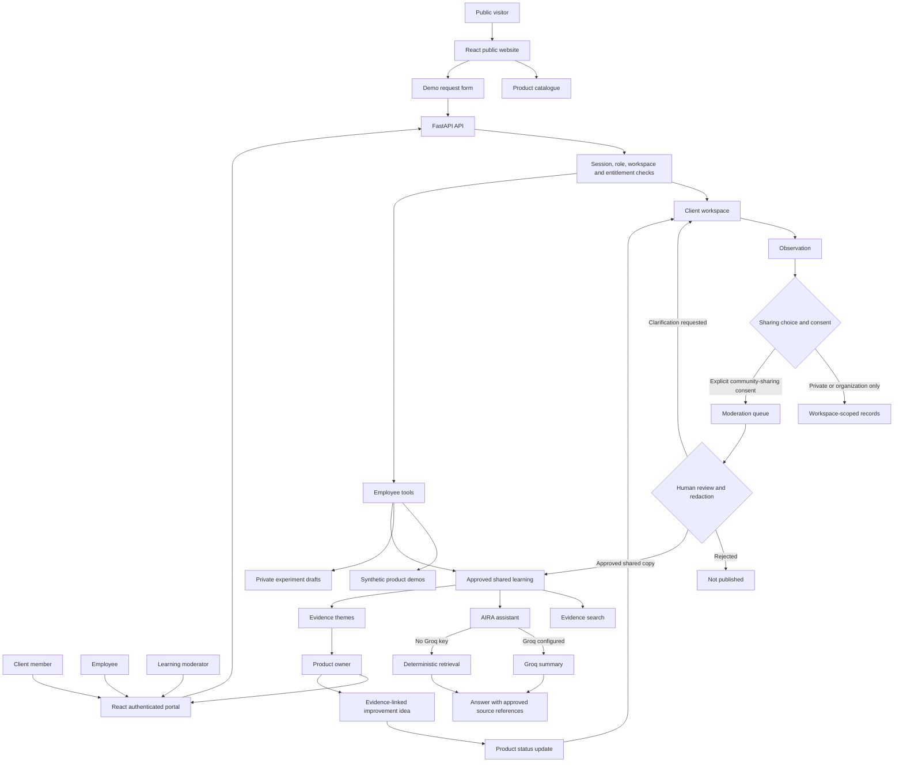

# Enterprise Client Learning Portal

An enterprise collaboration sub-product concept inspired by Azentio's financial technology domains. It is not Azentio's corporate website or an official Azentio product. The experience demonstrates how clients and employees could submit observations, have them reviewed, and turn approved evidence into product improvement ideas.

The frontend is a React single-page application built with Vite. FastAPI provides the API and serves the compiled React bundle in deployment. SQLite and fictional demo accounts are provided for local evaluation.

## How the platform works

The diagram shows the main user journey and the boundary between private client records and approved shared learning.



Private drafts and employee experiment drafts stay out of shared search and AIRA. Groq receives only the question and excerpts from approved shared contributions when configured.

## Run locally

Requires Python 3.10 or later.

```powershell
py -m venv .venv
.\.venv\Scripts\Activate.ps1
python -m pip install -r requirements.txt
Copy-Item .env.example .env
```

Use two terminals from the repository root. Start the API in the first:

```powershell
python -m uvicorn backend.main:app --reload --env-file .env
```

Install and start the React frontend in the second:

```powershell
cd frontend
npm ci
npm run dev
```

Open the Vite URL shown in the terminal (normally `http://localhost:5173`). Vite proxies `/api` requests to FastAPI. In development, the API schema is at `http://127.0.0.1:8000/docs`. The SQLite database is created at `backend/azentio.db` unless `AZENTIO_DB_PATH` is set.

## Synthetic demo accounts

When `AZENTIO_DEMO_SEED=true` (the default outside production), startup provisions fictional users and three fictional organizations. Unless overridden with `AZENTIO_DEMO_PASSWORD` before the first database initialization, the local development password is `Demo-Portal-2026!`.

The seed creates fictional private drafts, organization-visible observations, pending and clarification-requested contributions, and three approved cross-organization themes: Digital Onboarding, Payment Reconciliation, and Service Request Transparency. It also creates evidence-linked product ideas at different workflow stages, employee experiment drafts, notifications, and two synthetic upcoming learning sessions. The employee overview brings drafts, approved-evidence count, and upcoming sessions together. Seeding is idempotent and runs at API startup when enabled; restart FastAPI after changing this setting. These records are fictional presentation data, not Azentio customer research or market findings.

- `maya@meridian.test` - Meridian Finance client member
- `admin@meridian.test` - Meridian Finance client administrator
- `client@horizon.test` - Horizon Islamic Bank client member
- `client@summit.test` - Summit Financial Services client member
- `moderator@azentio.test` - learning moderator
- `publisher@azentio.test` - content publisher
- `owner@azentio.test` - product owner
- `portaladmin@azentio.test` - portal administrator
- `employee@azentio.test` - employee

Open `/login`, choose a synthetic account, and use the password above. Demo records are fictional. Never enter real customer, account, transaction, or confidential information.

### Optional Groq-powered AIRA

AIRA searches only approved, consented shared contributions. By default it returns deterministic evidence retrieval. To enable a Groq summary, create a Groq API key, put it in `GROQ_API_KEY` in your local `.env`, and restart FastAPI. `GROQ_MODEL` defaults to `llama-3.3-70b-versatile` and can be changed to another model available to your Groq account. The key stays on the server; the user's question and retrieved approved shared representations are sent to Groq. Private drafts, organization-only observations, moderation notes, and employee-only material are not included. If Groq is unavailable, AIRA falls back to deterministic evidence retrieval. Groq model access, free-tier limits, and availability depend on your account and may change.

Suggested judging flow:

1. Sign in as `maya@meridian.test`, open My observations, and create a synthetic contribution. Keep it private, share it with the organization, or request community review with the separate consent checkbox.
2. Sign in as `moderator@azentio.test`, review the queue, edit the proposed shared representation, and approve or request clarification. Use the seeded Summit contribution to demonstrate clarification and resubmission.
3. Sign in as `client@summit.test` to edit and resubmit the returned item, then approve it as moderator.
4. Open Shared learning or Evidence themes and search the seeded Digital Onboarding, Payment Reconciliation, or Service Request Transparency examples. Ask AIRA about reconciliation or onboarding; it returns approved evidence references and uses deterministic retrieval if Groq is not configured.
5. Sign in as `owner@azentio.test` to inspect the evidence-linked idea pipeline, or create an idea using displayed `OBS-...` references. Status updates can appear in client Improvement updates.
6. Sign in as `employee@azentio.test` to see experiment drafts and the upcoming session cards on the overview, then open Approved learning, Live sessions, or Product demos.

## Included workflows

- React and Vite frontend with an Azentio-inspired responsive landing page, product catalogue and detail templates, demo request form, and role-aware portal.
- Signed, expiring HttpOnly session cookies; passwords are hashed with scrypt. Login errors do not reveal whether an account exists. Local per-process throttling limits repeated attempts.
- Role-checked client, client administrator, employee, moderator, product owner, and portal administrator API paths.
- Workspace switching validated against server-loaded memberships and client product entitlement checks.
- Tenant-scoped synthetic product demonstration runs.
- Private-by-default observation drafts, explicit processing consent, separately recorded sharing, attribution, and model-training consent, author-only draft access, organization-visible contributions, clarification and resubmission, version history, and withdrawal.
- Moderation workflow with private originals separated from reviewed shared representations, basic sensitive-string warnings, approve / clarify / reject / unpublish actions, contributor notifications, and audit events.
- Approved shared-learning search and theme grouping. Cross-organization themes require a configurable cohort (default three) and state that cohort size is not a formal anonymity guarantee.
- AIRA retrieval over approved shared evidence, with source references, uncertainty boundaries, optional Groq-generated grounded summaries, and deterministic fallback.
- Evidence-linked improvement ideas, client-safe updates, status audit history, team access listing / revocation, and employee experiment drafts.
- Content Security Policy and baseline security headers, origin checks on API mutations, production-required session secret, API docs disabled in production mode, and a non-root container image.

## API groups

- `/api/auth/*` - sign-in, sign-out, identity, workspace selection.
- `/api/client/*` - dashboard, entitled products, demos, observations, team, client updates.
- `/api/moderation/*` - review queue, published learning, and contribution reports.
- `/api/shared-learning`, `/api/aira/*`, `/api/bookmarks`, `/api/notifications` - approved learning and user resources.
- `/api/product-owner/*` - evidence-linked ideas and status updates.
- `/api/employee/*` - internal experiment drafts, synthetic demos, approved learning, and live-session placeholder.
- `/api/audit` - privileged audit event view.

## Deployment configuration

Copy `.env.example` for local development. Before any internet-facing deployment:

- Set `AZENTIO_ENV=production`, `AZENTIO_SESSION_SECRET` to a randomly generated secret of at least 32 characters, `AZENTIO_ALLOWED_ORIGINS` to exact HTTPS origin(s), and `AZENTIO_DEMO_SEED=false`.
- Terminate TLS at a trusted reverse proxy, configure proxy trust deliberately, and apply shared rate limits at the gateway. The included login throttling is per process and is a local safeguard only.
- Replace local demo-password authentication with approved Entra ID / OIDC or another organization-managed identity provider. Add MFA, account lifecycle, session revocation, and centralized authorization policy.
- Replace SQLite with managed PostgreSQL and migrations before multi-worker or multi-instance use. The current database adapter is for a local, single-process demo and is not a production database layer.
- Configure private object storage, malware scanning, retention and deletion policy, backups, monitoring, secrets management, and email delivery before accepting real contributions or sending invitations.
- Review privacy notices, data residency, consent language, audit retention, accessibility, and product content with authorized teams.

`Dockerfile` builds the React bundle in a Node stage and copies it into the non-root FastAPI image. `compose.yaml` provides a container for evaluation and expects a local `.env`. The SQLite database persists only through the mounted volume; it is not a managed production database.

## Deliberate limits

This is a development-grade foundation, not a production-authorized financial services system. It does not implement OIDC / SSO, email delivery or invitation acceptance, file attachments, comments, live-event publishing, a real AI provider or vector index, an LLM, formal anonymization, or federated learning. The cohort minimum is a display gate, not a privacy guarantee. Product names and claims should be verified against approved Azentio materials before external publication. Do not use real customer or transaction data.
